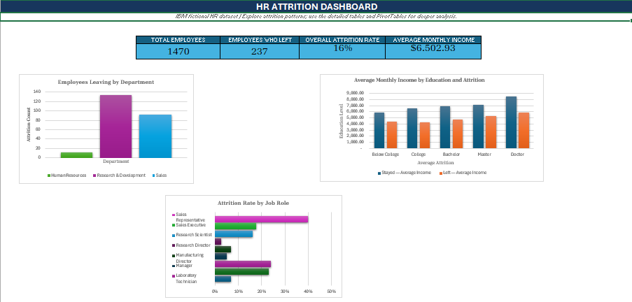

# HR Employee Attrition Analysis Using Microsoft Excel

An end-to-end HR analytics portfolio project exploring employee attrition patterns using Microsoft Excel, data-quality checks, calculated fields, PivotTables, KPI summaries, and an interactive dashboard.

**Tools:** Microsoft Excel | PivotTables | Excel formulas | Data visualization

## Dashboard Preview



*The dashboard summarizes employee attrition metrics and patterns across departments, job roles, and other workforce characteristics.*

## Project Overview

This project analyzes the IBM HR Employee Attrition practice dataset to explore employee turnover patterns and identify areas that may warrant further investigation. The workbook includes data preparation, quality checks, calculated fields, PivotTable analysis, KPI summaries, and dashboard visualizations.

## Business objective
Turn employee-level HR data into a clear, auditable Excel analysis that helps stakeholders ask better questions about employee retention. The dataset is fictional; findings should be presented as descriptive associations rather than causal conclusions.

## Dataset
- **Source file:** `WA_Fn-UseC_-HR-Employee-Attrition.csv`
- **Records:** 1,470 employees
- **Source columns:** 35
- **Missing cells found during initial inspection:** 0
- **Exact duplicate rows found during initial inspection:** 0
- **Data origin:** fictional dataset created by IBM data scientists and widely distributed for analytics practice.

Keep a copy of the original file in `data/raw/`. Do not overwrite it during cleaning.

## Tools
- Microsoft Excel (Excel Tables, formulas, PivotTables, PivotCharts, slicers, conditional formatting)
- Optional: GitHub for version control and portfolio presentation

## Repository structure
```text
hr-employee-attrition-excel/
├── data/
│   ├── raw/
│   │   └── WA_Fn-UseC_-HR-Employee-Attrition.csv
│   └── README.md
├── workbook/
│   └── HR_Employee_Attrition_Excel_Portfolio.xlsx
├── dashboard/
│   └── dashboard_screenshot.png
├── docs/
│   └── data_dictionary.md
├── README.md
└── .gitignore
```

## Workbook guide
- `Read_Me`: project purpose, workbook navigation, and interpretation notes.
- `Raw_Data`: untouched copy of the source data.
- `Cleaned_Data`: analysis-ready copy, readable labels for ordinal codes, an attrition flag, and income/distance bands.
- `Data_Dictionary`: definitions and handling notes for the source columns.
- `Data_Quality`: data-quality checks and the initial inspection results.
- `KPI_Summary`: formula-driven metrics and group summaries.
- `Dashboard`: headline KPI cards and charts.
- `Analysis_Plan`: questions, PivotTable designs, and interpretation cautions.

## Cleaning and preparation
1. Preserved the original 35-column source in `Raw_Data`.
2. Confirmed the initial file has 1,470 rows, 35 columns, no missing cells, and no exact duplicate rows.
3. Added readable labels for `Education`, `EnvironmentSatisfaction`, `JobInvolvement`, `JobSatisfaction`, `PerformanceRating`, `RelationshipSatisfaction`, and `WorkLifeBalance`.
4. Added `Attrition_Flag` (`Yes` = 1, `No` = 0).
5. Added `Income_Band` and `Distance_Band` for grouped comparisons.
6. Kept employee identifiers for row-level traceability, but they should not be averaged or treated as explanatory variables.

## Core metrics
- **Attrition rate** = employees with `Attrition = Yes` / all employees.
- **Attrition count** = count of employees with `Attrition = Yes`.
- **Group attrition rate** = employees who left in a group / all employees in that group.
- **Average monthly income** = average of `MonthlyIncome` for the selected group.

Always compare group rates as well as counts; counts alone can make larger departments appear riskier simply because they have more employees.

## Suggested PivotTables
### 1. Attrition by department and job role
- Rows: `Department`, then `JobRole`
- Columns: `Attrition`
- Values: Count of `EmployeeNumber`
- Show values as `% of Row Total` for a within-group comparison.
- Add a bar chart and slicers for `Department`, `OverTime`, and `Gender` only when appropriate for descriptive exploration.

### 2. Distance from home by job role and attrition
- Rows: `JobRole`
- Columns: `Attrition`
- Values: Average of `DistanceFromHome`
- Optional second value: Count of `EmployeeNumber`
- Consider a separate PivotTable using `Distance_Band` to compare distributions.

### 3. Average monthly income by education and attrition
- Rows: `Education_Label`
- Columns: `Attrition`
- Values: Average of `MonthlyIncome`
- Format as currency/number with separators. Keep the education order Below College, College, Bachelor, Master, Doctor.

### 4. Overtime and attrition
- Rows: `OverTime`
- Columns: `Attrition`
- Values: Count of `EmployeeNumber`
- Show values as `% of Row Total`; visualize as a 100% stacked bar chart.

### 5. Satisfaction and attrition
Repeat a PivotTable for each satisfaction field using the human-readable label. Compare row percentages, not just counts.

### 6. Tenure and attrition
- Rows: `Attrition`
- Values: Average of `YearsAtCompany`, `YearsInCurrentRole`, and `YearsWithCurrManager`
- Add median calculations separately if you want a more robust view of skewed tenure distributions.

## Recommended dashboard design
1. KPI cards: total employees, employees who left, attrition rate, average monthly income.
2. Chart 1: attrition count by department.
3. Chart 2: attrition rate by overtime status.
4. Add PivotCharts from the recommended PivotTables for job role, satisfaction, and education/income.
5. Add slicers (where supported): Department, JobRole, OverTime, Attrition, and Education_Label.
6. Keep labels readable, use consistent colors, and avoid overcrowding the dashboard.

## Formula examples
Assuming the Excel Table on `Cleaned_Data` is named `CleanEmployeeData`:

```excel
=COUNTA(CleanEmployeeData[EmployeeNumber])
=COUNTIF(CleanEmployeeData[Attrition],"Yes")
=COUNTIF(CleanEmployeeData[Attrition],"Yes")/COUNTA(CleanEmployeeData[EmployeeNumber])
=AVERAGE(CleanEmployeeData[MonthlyIncome])
=COUNTIFS(CleanEmployeeData[OverTime],"Yes",CleanEmployeeData[Attrition],"Yes")/COUNTIF(CleanEmployeeData[OverTime],"Yes")
```

For a group-level attrition rate (e.g., a job role named in cell A2):
```excel
=COUNTIFS(CleanEmployeeData[JobRole],A2,CleanEmployeeData[Attrition],"Yes")/COUNTIF(CleanEmployeeData[JobRole],A2)
```

## Key questions to answer in the final write-up
- What is the overall attrition rate?
- Which job roles and departments have the highest and lowest attrition rates?
- How does attrition vary with overtime?
- How does average monthly income compare by education and attrition?
- Does distance from home differ between employees who left and those who stayed, by role?
- How do satisfaction scores and work-life balance vary by attrition?
- How do tenure and years with the current manager differ between leavers and stayers?

Do not write conclusions until you have checked the PivotTable outputs. Use the numbers produced by your final workbook, and include the relevant denominators.

## Limitations and responsible interpretation
- This is a fictional dataset and may not represent any real employer.
- It is observational and cross-sectional; associations do not establish causation.
- Some categories contain fewer records than others, so rates for small groups can be unstable.
- Demographic and other sensitive attributes should be handled carefully and not used to justify discriminatory employment decisions.
- The analysis is descriptive, not a predictive model or an employee-level risk score.

## Deliverables checklist
- [x] Source data preserved in the workbook
- [x] Analysis-ready data with mapped labels and derived bands
- [x] Data dictionary and quality checks
- [x] Formula-driven KPI summary
- [x] Starter dashboard with charts
- [x] Business questions and PivotTable plan
- [ ] Build and format final PivotTables/PivotCharts in Excel
- [ ] Add slicers and test dashboard interactions
- [ ] Capture a dashboard screenshot for GitHub/LinkedIn
- [ ] Replace draft findings with verified insights from Excel outputs
- [ ] Add final screenshot and project link to portfolio

## How to use
1. Open the workbook in desktop Microsoft Excel.
2. Check the `Data_Quality` sheet and allow formulas to recalculate.
3. Review `KPI_Summary` and `Dashboard`.
4. Create the PivotTables described in `Analysis_Plan` using `Cleaned_Data`.
5. Add slicers and finalize the dashboard.
6. Save a screenshot to `dashboard/dashboard_screenshot.png`.
7. Update this README with your verified findings and publish the workbook/project files.

## Suggested GitHub description
**Excel-based HR analytics project exploring employee attrition patterns by department, job role, overtime, satisfaction, income, distance from home, and tenure. Includes data preparation, data dictionary, quality checks, formula-driven KPIs, and an interactive dashboard roadmap.**
